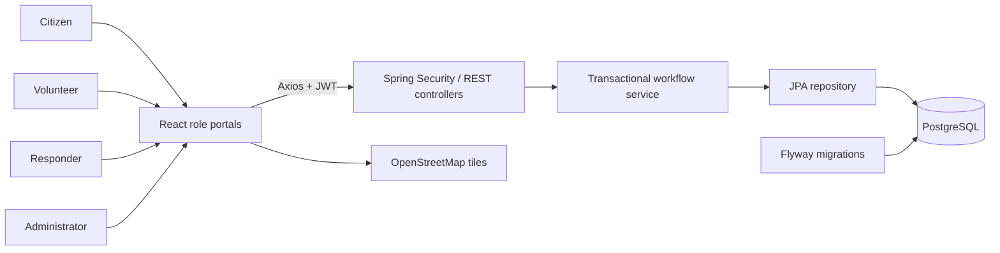

# NEXUS — Disaster Response Coordination Platform

**Connecting Communities. Coordinating Response. Saving Lives.**

An installable, India-wide Progressive Web App for a semester / Professional Training I project, connecting citizens, volunteers, rescue responders, and administrators. Reports, response progress, tasks, supply requests, allocations, and emergency bulletins persist in PostgreSQL.

> All seeded identities, incidents, locations of incidents, alerts, and assignments are fictional training data. This project is not connected to emergency services.


## Nationwide PWA upgrade

- **Installable app:** standalone app window, app icons, offline public shell, connection feedback, and update prompts. Open `/app` to enter the workspace directly.
- **All India:** all 28 states and 8 union territories; state/district incident reporting and state/source filters. Maps start at India and recenter correctly when a state or pin changes.
- **Live India:** Open-Meteo/CAMS air-quality estimates (PM2.5, PM10, US AQI) and MET Norway weather forecasts for a named sample point in every state/UT, custom coordinates, and upcoming forecast intervals, and a separate USGS regional earthquake feed. Every feed shows its source, data time, fetch time, and availability.
- **Honest data separation:** seeded fictional reports and QA records have source labels. Live provider data never automatically verifies incidents or dispatches teams.
- **Reliability fixes:** independent sidebar scrolling, modal keyboard support, duplicate-submit protection, preserved sessions during connection failure, stock-edit conflict detection, consistent responder lock ordering, and database-backed health checks.

Read [PWA installation](docs/PWA-INSTALL.md), [semester demo and viva guide](docs/SEMESTER-DEMO.md), and the [latest verification report](VERIFICATION.md).

On this computer, use regular **Chrome or Edge** at `http://localhost:5173` and select **Install NEXUS**. VS Code's embedded preview may not support installation. A phone needs a reachable **HTTPS deployment**; its own localhost is not this laptop. No public deployment was made.

## Start on this Windows computer

Open `D:\nexus_disaster` in VS Code. Open **Terminal → New Terminal**, select PowerShell, and run:

```powershell
cd D:\nexus_disaster
powershell -ExecutionPolicy Bypass -File .\start-demo.ps1
```

Open **http://localhost:5173**. First startup may take a minute. The API health URL is **http://localhost:8080/api/health**.

The launcher uses an isolated PostgreSQL database on **127.0.0.1:55432**, not your existing PostgreSQL service on 5432. It keeps data in ignored `.runtime/postgres`. PostgreSQL 15 is expected at `C:\Program Files\PostgreSQL\15\bin`. Portable Node 22 is available in ignored `.tools/node-v22.16.0-win-x64`; Maven is discovered on PATH or under your user `Tools/apache-maven-3.9.16/bin` directory. These local tool binaries are **not** part of the GitHub source.

The launcher builds and serves the production PWA, and starts backend/frontend processes with hidden windows and logs to `.runtime/backend.log`, `.runtime/backend-error.log`, `.runtime/frontend.log`, and `.runtime/frontend-error.log`. If a port is already occupied, it leaves that process untouched. An occupied port is not proof that NEXUS is running; check the URLs above.

For visible logs, use three terminals instead:

```powershell
# Terminal 1: database (returns after startup)
powershell -ExecutionPolicy Bypass -File .\scripts\start-database.ps1

# Terminal 2: backend (keep open)
powershell -ExecutionPolicy Bypass -File .\scripts\start-backend.ps1

# Terminal 3: frontend (keep open)
powershell -ExecutionPolicy Bypass -File .\scripts\start-frontend.ps1
```

Press Ctrl+C in a foreground app terminal to stop that app. To stop the isolated database after closing the backend:

```powershell
& 'C:\Program Files\PostgreSQL\15\bin\pg_ctl.exe' -D 'D:\nexus_disaster\.runtime\postgres' stop -m fast
```

## Demo credentials — local development only

All demo accounts use **`NexusDemo123!`**. The login screen has role buttons that fill these credentials; click **Sign in** to authenticate against the API.

| Role | Primary email | Additional fictional accounts |
|---|---|---|
| Administrator | `admin@nexus.demo` | None |
| Citizen | `citizen@nexus.demo` | `citizen2@nexus.demo`, `citizen3@nexus.demo` |
| Volunteer | `volunteer@nexus.demo` | `volunteer2@nexus.demo`, `volunteer3@nexus.demo` |
| Responder | `responder@nexus.demo` | `responder2@nexus.demo`, `responder3@nexus.demo` |

Public registration allows citizens and volunteers. Responders and administrators are trusted seeded accounts, not publicly self-selected privileges. Password hashes never appear in API JSON. JWTs expire after eight hours and are held in browser session storage; logout removes the current browser token. Existing tokens are not centrally revoked.

## Problem and objectives

Fragmented emergency reports, disconnected teams, and unclear supply availability make coordination difficult. NEXUS provides a shared system for location-based incident reporting, verification, priority classification, rescue coordination, volunteer assignments, resource allocation, emergency notifications, incident tracking, and centralized monitoring.

The original four-role architecture and objectives from the supplied specification are preserved. No presentation file was attached, so comparison with presentation slides could not be performed.

## Features

- Public homepage, project overview, registration, login, protected routes, and editable profiles.
- Citizen reports with disaster type, severity, affected population, contact details, address, map pin, validation, and persistent history.
- Administrator review, rejection, assessed severity, final priority, and transparent priority recommendations.
- Responder assignment, team information, dispatch/in-progress/resolved updates; updates appear for the reporting citizen.
- Volunteer skills/availability, tasks, accepted/in-progress/completed transitions, and task history.
- Six resource categories: water, food, medicine, shelter, rescue assistance, and other supplies.
- Resource requests, approval/rejection, inventory editing, transactional allocation, duplicate approval protection, and nonnegative stock constraints.
- Published location-labelled alerts on every role portal; automatic 30-second refresh.
- Leaflet/OpenStreetMap situation maps, priority colours, marker details, and incident search/filtering.
- Backend-derived metrics and Recharts analytics: disaster type, priority, response status, monthly trends, inventory, and volunteer task status.
- Responsive navy/slate interface, green response accents, warning badges, confirmation dialogs, loading/error/empty states, and success notifications.

## Stack and architecture

| Layer | Technology |
|---|---|
| Frontend | React 19, Vite 6, Tailwind CSS 4, React Router, Axios, Lucide |
| Visualizations | Recharts, React Leaflet, OpenStreetMap |
| Backend | Java 17+, Spring Boot 3.5.6, Spring Security, Spring Web, Validation |
| Persistence | Spring Data JPA/Hibernate, PostgreSQL, Flyway |
| Authentication | BCrypt, signed HS256 JWT via Spring OAuth2 Resource Server |
| Checks | JUnit 5 + Spring MockMvc/H2; real PostgreSQL HTTP smoke tests |



Authorization is enforced in the backend, including ownership checks for incidents and assignments. The frontend protects route access for usability but is not the security boundary. Records are shared between role views through the API, not simulated with browser state.

## Source structure

```text
frontend/
  src/components/     Shared forms, badges, modal, map
  src/context/        Authentication state
  src/layouts/        Sidebar and workspace shell
  src/pages/          Public pages and operational portals
  src/services/       Axios client and error handling
  src/main.jsx        Explicit protected route tree
  src/styles.css      Responsive visual design and Tailwind directives
backend/
  src/main/java/com/nexus/disasterresponse/
    config/           Repeatable fictional demo seed
    controller/       REST API
    dto/              Validated request records
    entity/           Relational domain models
    exception/        JSON error responses
    repository/       EntityManager-backed JPA repository
    security/         JWT, BCrypt, CORS, stateless security
    service/          Authorization, transitions, transactions, analytics
  src/main/resources/db/migration/  Flyway schema
  src/test/           Workflow/security integration tests
database/             Schema explanation
scripts/              Windows startup helpers and HTTP smoke test
start-demo.ps1        Local launcher
docker-compose.yml    Optional PostgreSQL + backend containers
```

## Database design

`users` optionally belong to `rescue_teams`. Each `incident` belongs to its reporting user and has `incident_status_history`. `assignments` link responders or volunteers to incidents and have `assignment_history`. `resource_requests` link a citizen to an inventory resource; approved requests have one unique `resource_allocation` with the approving administrator. `emergency_alerts` identify the publishing administrator.

The schema includes foreign keys, unique email/resource/allocation constraints, indexed ownership/status columns, timestamps, coordinate limits, and stock/request quantity checks. Both request and resource rows are locked during approval in one transaction. Failed or duplicate approval rolls back without reducing stock.

The authoritative migration is `backend/src/main/resources/db/migration/` (V1 base schema, V2 nationwide/source fields); Hibernate validates it on startup. Do not manually rerun it. For future schema changes, add a new numbered Flyway migration instead of editing an already-applied migration.

The first startup creates 10 users, 2 rescue teams, 12 incidents around Chennai, 14 initial assignments, 6 inventory resources, 3 requests, histories, and 2 alerts. Seeding is atomic and skipped when the demo administrator exists. The smoke test retains additional records clearly labelled `QA` or `Fictional`. Latest upgrade testing used a separate `nexus_audit` database, preserving existing project reports.

## Prerequisites on another computer

- Java 17 or newer (tested here with Java 25.0.1).
- Maven 3.9+ (tested with 3.9.16).
- Node.js 22+ and npm (tested with portable Node 22.16.0).
- PostgreSQL 15+ (tested with 15.16), or Docker with Compose.
- Git for publishing the source.

Verify these before installing project dependencies:

```powershell
java -version
mvn -version
node --version
npm.cmd --version
psql --version
git --version
docker --version # Optional
```

## PostgreSQL setup on another computer

Use pgAdmin's Query Tool or `psql` as your PostgreSQL administrator. These are development-only example credentials:

```sql
CREATE USER nexus WITH PASSWORD 'nexus_local_only';
CREATE DATABASE nexus OWNER nexus;
```

Alternatively, start only the Compose database:

```powershell
docker compose up -d db
```

To use the Windows isolated database helper with a different PostgreSQL version:

```powershell
powershell -ExecutionPolicy Bypass -File .\scripts\start-database.ps1 -PgBin 'C:\Program Files\PostgreSQL\16\bin'
```

The isolated helper uses loopback-only trust authentication for a local fictional demonstration. Use password authentication and appropriate credentials for any shared environment.

## Backend installation and startup

For a normal database on port 5432, open a PowerShell terminal in the project root:

```powershell
cd .\backend
$env:DB_URL='jdbc:postgresql://localhost:5432/nexus'
$env:DB_USERNAME='nexus'
$env:DB_PASSWORD='nexus_local_only'
$env:CORS_ALLOWED_ORIGINS='http://localhost:5173,http://127.0.0.1:5173'
mvn test
mvn spring-boot:run
```

For the project-local database, use `jdbc:postgresql://127.0.0.1:55432/nexus` or the startup helper. The root `.env.example` documents configuration. Spring does **not** automatically read `.env`; set PowerShell environment variables as shown. Docker Compose reads its root `.env` when present.

The built-in JWT secret is marked local-demo-only. Before a nonlocal deployment, set `JWT_SECRET` to a random secret of at least 32 bytes, use real credentials, disable demo seeding with `SEED_DEMO=false`, use HTTPS, and restrict CORS to your frontend origin.

Optional containerized backend and database:

```powershell
docker compose up --build -d
```

The frontend still runs with npm. Docker was not available on this computer; the Compose path has not been executed here.

## Frontend installation and startup

Open a separate terminal from the project root:

```powershell
cd .\frontend
Copy-Item .env.example .env
npm.cmd ci
npm.cmd run dev
```

The frontend calls same-origin `/api` by default. Vite development/preview proxies that path to the local backend on port 8080. The HTTPS deployment template does the same through Caddy. Set `VITE_API_BASE_URL` only for a deliberately separate API host, then rebuild. Avoid hardcoded laptop localhost URLs in a phone deployment. The dev server uses port 5173 and refuses to silently switch ports.

Production build:

```powershell
npm.cmd run build
npm.cmd run preview
```

Production preview uses port 5173 and the same-origin API proxy. Stop the development server first if it occupies that port. Production hosting must rewrite frontend routes to `index.html`.

## REST API

All protected requests use `Authorization: Bearer <token>`. Inputs are validated. Failures return JSON with a `message` field for handled validation, authorization, missing records, and conflicts.

| Method and route | Permission / behaviour |
|---|---|
| `GET /api/health` | Public health response with a real database query |
| `GET /api/regions` | Authenticated directory of all 36 states/UTs |
| `GET /api/live/weather?stateCode=DL` | Authenticated near-current forecast estimates; optional `latitude` and `longitude` |
| `GET /api/live/earthquakes` | Authenticated regional USGS feed |
| `POST /api/auth/register` | Public citizen/volunteer registration |
| `POST /api/auth/login` | Public login, returns token + safe user JSON |
| `GET/PATCH /api/auth/me` | Current account/profile |
| `GET /api/users` | Admin coordination directory |
| `GET /api/teams` | Admin/responder teams |
| `POST /api/incidents` | Citizen report |
| `GET /api/incidents`, `/api/incidents/my` | Admin: all; citizen: owned; workers: assigned |
| `GET /api/incidents/{id}` | Same visibility restrictions |
| `GET /api/incidents/{id}/history` | Authorized incident history |
| `GET /api/incidents/{id}/recommendation` | Explainable priority suggestion |
| `PATCH /api/incidents/{id}/verify` | Admin decision, priority, optional assessed severity |
| `PATCH /api/incidents/{id}/status` | Admin or assigned responder |
| `GET /api/assignments`, `/api/assignments/my` | Admin: all; workers: own |
| `POST /api/assignments` | Admin, verified active incidents only |
| `PATCH /api/assignments/{id}/status` | Assigned worker only |
| `GET /api/assignments/{id}/history` | Admin or assigned worker |
| `GET /api/resources` | Authenticated inventory |
| `POST /api/resources`, `PATCH /api/resources/{id}` | Admin inventory management |
| `POST /api/resource-requests` | Citizen request |
| `GET /api/resource-requests` | Admin: all; citizen: own |
| `PATCH /api/resource-requests/{id}/review` | Admin approval/rejection, transactional allocation |
| `GET /api/alerts`, `POST /api/alerts` | Read: signed in; publish: admin |
| `GET /api/analytics/overview` | Role-scoped dashboard metrics |
| `GET /api/analytics/incidents`, `/api/analytics/resources` | Admin analytics |

Example PowerShell API check:

```powershell
$login = Invoke-RestMethod -Method Post -Uri 'http://localhost:8080/api/auth/login' -ContentType 'application/json' -Body '{"email":"admin@nexus.demo","password":"NexusDemo123!"}'
$headers = @{ Authorization = "Bearer $($login.token)" }
Invoke-RestMethod -Uri 'http://localhost:8080/api/analytics/overview' -Headers $headers
```

Never paste a real token into the README or commit it.

## Faculty demonstration: flood emergency in Chennai

1. Open the homepage and explain the four connected roles and response workflow.
2. Sign in as `citizen@nexus.demo`. Choose **Report incident**.
3. Select **Tamil Nadu**, enter district/city **Chennai**, a flood title, description, Velachery address, **High** severity, 35 affected people, and fictional contact information. Click the map or enter `12.9815`, `80.2180`.
4. Submit. Open **My reports**, inspect its pending verification badge and initial history. Note its incident ID.
5. Sign out and sign in as `admin@nexus.demo`. Open **Incidents**, search the title, and open the report.
6. Explain the rule-based recommendation. Select **Verified**, **High** priority, assessed severity, and a review note. Save.
7. Open **Rescue coordination**. Select the incident and **Vikram Shah — Responder**, add evacuation instructions, and assign.
8. Sign out and sign in as `responder@nexus.demo`. Open **Operations**. Update the task to **In Progress**, then **Resolved**, with progress notes.
9. Sign in as the original citizen and open the report to show its resolved status and saved history.
10. Sign in as administrator and show updated dashboard metrics and analytics.
11. Resource demo: citizen requests water; administrator opens **Resource requests**, reviews and approves. Show the reduced inventory and citizen's approved request. Approving more than available stock returns an error without changing inventory.
12. Volunteer demo: on a different active verified incident, assign a task to **Kavya Raj**. Sign in as `volunteer@nexus.demo`; accept, start, and complete it. Show task history and editable skills/availability.
13. Alert demo: administrator publishes a clearly labelled fictional alert. Open the citizen or volunteer alerts page to show it.
14. Open the administrator situation map, filter by priority, and click an incident marker.

Use a separate tab/window for simultaneous role sessions; session storage is scoped to the browser tab. Signing in as another role in one tab changes that tab's role. Data refreshes every 30 seconds, and **Refresh** fetches immediately.

## Verification

Backend integration tests use an isolated in-memory H2 database, never your demonstration database:

```powershell
cd .\backend
mvn test
```

Real PostgreSQL HTTP verification requires the running backend:

```powershell
# From the project root with Node on PATH:
node .\scripts\smoke-test.mjs
# Or use the portable Node already installed on this machine:
& '.\.tools\node-v22.16.0-win-x64\node.exe' '.\scripts\smoke-test.mjs'
```

The HTTP script creates and retains fictional QA records. It tests registration/login, JWT protection, role/ownership boundaries, incident creation/review/assignment/resolution/history, volunteer progression, resource approval, concurrent stock contention, duplicate approval rejection, alerts, profile persistence, and analytics retrieval. Run it against a development database only.

See [VERIFICATION.md](VERIFICATION.md) for actual execution results and limitations.

## Screenshots

Browser automation was unavailable in this session, so no screenshots are presented as verified captures. For your submission, capture the homepage, administrator overview, incident detail/history, situation map, and analytics after starting the application. Store your captures under `docs/screenshots/` and add links here.

## GitHub upload

The `.gitignore` excludes dependencies, build output, environment files, local tools, runtime databases, and logs. The package lock is included for reproducible frontend installation. No repository was pushed.

From the project root, after reviewing files and creating an empty repository on GitHub:

```powershell
git init
git add .
git status
git commit -m "Initial commit - NEXUS Disaster Response Platform"
git branch -M main
git remote add origin YOUR_GITHUB_REPOSITORY_URL
git push -u origin main
```

Only example development credentials belong in source. Do not upload `.env`, `.runtime`, `.tools`, `node_modules`, or `target` manually.

## Scope and future improvements

- Optional incident image upload is not implemented.
- Alerts are shared, location-labelled bulletins, not geofenced delivery. No SMS, email, push delivery, or per-user read/unread notifications.
- Profiles support availability and skills; administrator provisioning of new responders, team editing, password reset, and account deactivation are future features.
- External maps, live feeds, and Google Fonts need internet; local system fonts remain available if fonts fail. No offline map tiles or guaranteed tile availability.
- Priority suggestions are simple rules, not machine learning: severity score 1–4, plus population increments and disaster-type risk; administrator decides the final classification.
- Analytics count records in the database and bucket incident creation timestamps in India time. They do not represent response-time SLAs or historical inventory trends.
- List endpoints are intentionally unpaginated for this small demo. Production scale needs paginated database queries, rate limiting, monitoring, backups, token revocation, and hardened deployment configuration.
- No presentation attachment was available for slide-by-slide verification. Docker and browser visual/mobile interactions could not be verified in this environment.

## Troubleshooting

**API unavailable:** inspect `.runtime/backend.log` or the terminal; check PostgreSQL, database URL, and port 8080. The local helper uses 55432; default manual configuration uses 5432.

**Login fails:** ensure demo seeding is enabled, use the exact demo password, and check that the API points to this project's database.

**CORS:** use localhost/127.0.0.1 port 5173, or add the actual origin to `CORS_ALLOWED_ORIGINS` and restart the API.

**PowerShell script policy:** use the provided `powershell -ExecutionPolicy Bypass -File ...` invocation for that process. No system-wide policy change is needed.

**Port already used:** the launcher does not terminate unrelated programs. Inspect the application on that port and stop it yourself if appropriate, or use the existing NEXUS instance.

**npm not found:** open a new terminal after installing Node, or use `scripts/start-frontend.ps1` to select the project-local portable Node installation.

**Map tiles unavailable:** numeric latitude/longitude and address entry still work. Use an internet connection for map tiles.


## Live sources and freshness

- [MET Norway Locationforecast](https://api.met.no/weatherapi/locationforecast/2.0/documentation): global point forecasts, not station observations or official warnings. NEXUS identifies itself, caches for at least ten minutes and respects Expires, Last-Modified and Retry-After headers. Wind is converted from m/s to km/h; rainfall is labelled with its forecast interval. MET Norway attribution and the CC BY 4.0 licence appear in the app. No API key is required. Open-Meteo/CAMS remains the separate air-quality source.
- [USGS GeoJSON summary feed](https://earthquake.usgs.gov/earthquakes/feed/v1.0/geojson.php): past-seven-day earthquake events, refreshed by NEXUS every five minutes, filtered to 6?38?N and 68?98?E. This rectangular area includes neighbouring countries and offshore events. It is not an administrative-border filter or an exhaustive earthquake catalogue.
- [National Portal state/UT directory](https://www.india.gov.in/directory/web-directory/state-uts): region names are represented in `shared/india-regions.json`. Sample coordinates are named city points, not entire-state observations or official boundaries.

Provider failures return `UNAVAILABLE` when no data exists or `STALE` with the original fetch timestamp when last-known data exists. No random/sample weather or earthquake results are substituted. There is no official IMD/NDMA/CWC all-disaster warning ingestion in this release.

## Repeatable semester checks

```powershell
powershell -ExecutionPolicy Bypass -File .\scripts\check-project.ps1
```

Add `-IncludeDataTests` only when you want the HTTP smoke script to create fictional QA records. To check live weather retrieval for all 36 region sample points:

```powershell
& '.\.tools\node-v22.16.0-win-x64\node.exe' '.\scripts\check-live.mjs' --all
```

Frontend code formatting is available through `npm run format` and `npm run format:check` in `frontend`. Java formatting is available through `npm run format:java` there. Formatting dependencies are development-only.


## October 18 predeployment audit and live air quality

Live India now includes `/api/live/air-quality?stateCode=DL` (authenticated),
with optional paired latitude/longitude. It uses Open-Meteo's CAMS global model,
shows PM2.5, PM10 and US AQI, and refreshes the cached result every ten minutes.
These are model estimates, not local sensor measurements or India's CPCB AQI.
The upstream model updates less frequently than app refreshes.
Source: https://open-meteo.com/en/docs/air-quality-api

Each feed owns its loading/error state and cancels superseded location requests.
Invalid provider payloads are unavailable; failed refreshes keep dated last-known
results marked stale. Weather, pollution and earthquake feeds never create rescue
reports or official emergency alerts automatically.

Run browser checks with the app and API running:

```powershell
cd frontend
npm run test:browser
```

The browser suite defaults to installed Microsoft Edge. Set BROWSER_CHANNEL=chrome
for installed Chrome. Phone checks emulate a viewport; test installation on a real
Android/iPhone after HTTPS hosting. See docs/PREDEPLOYMENT-AUDIT.md for results and
remaining deployment requirements.


## Render deployment

[Deploy the academic demo on Render](https://render.com/deploy?repo=https://github.com/arishashiraz/Nexus_Disaster)

The repository includes a combined app/API Docker image and a `render.yaml`
Blueprint for a free web service and PostgreSQL database. See
[Render setup and limitations](docs/RENDER-DEPLOY.md). A Render account is required;
this link starts setup and is not an already-running app URL. Free PostgreSQL
expires after 30 days. The Blueprint enables public fictional demo accounts.
